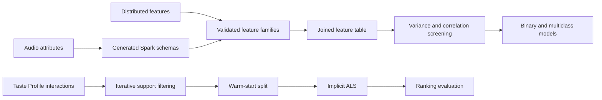
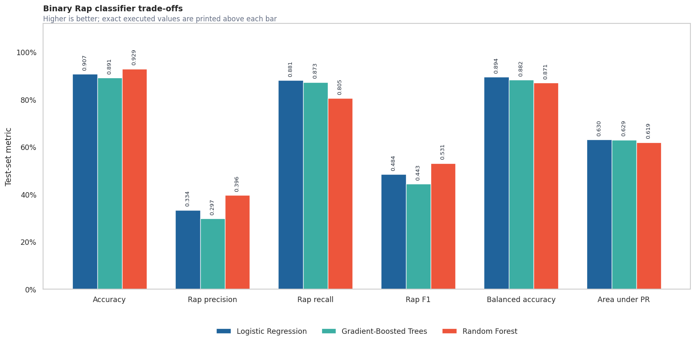
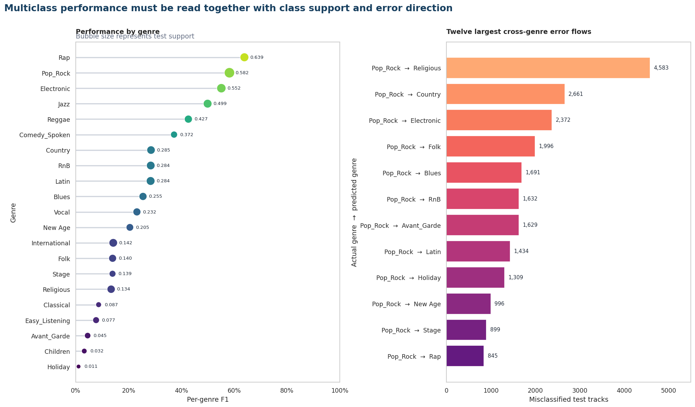
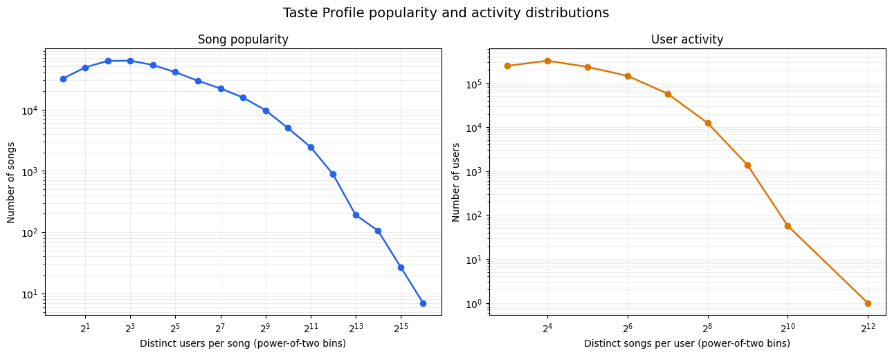
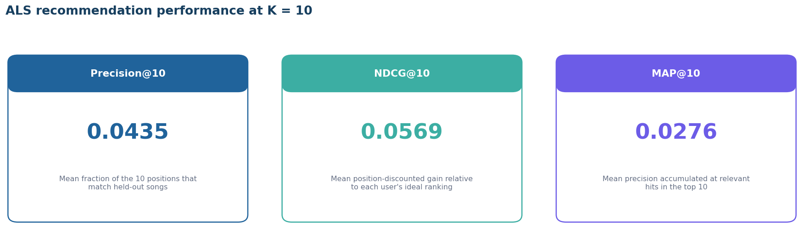

# Million Song Spark ML and Recommender

## Overview

This case study combines distributed audio-feature engineering, imbalanced genre classification, and implicit-feedback recommendation using the Million Song Dataset ecosystem.

The inspected cloud copy occupied **12.903 GiB** and contained main metadata, genre labels, 13 audio-feature families, and Taste Profile interactions. These sources operate at different grains—feature definition, track, song, genre label, and user-song interaction—so key and grain validation preceded every join.

## End-to-end workflow

## Audio-feature pipeline

1. Matched attribute-definition files to their distributed feature datasets.
2. Generated Spark `StructType` schemas programmatically.
3. Normalised feature names to prevent collisions across families.
4. Removed invalid identifiers and reconciled repeated source rows.
5. Inner-joined five selected feature families, producing **993,828 complete tracks**.
6. Removed zero-variance columns and screened highly correlated features.
7. Reduced **238 non-constant candidates to 173 retained features**.
8. Joined features to genre labels, producing a **420,242-track modelling table**.

## Classification

Three weighted binary classifiers were evaluated for Rap versus other genres: Logistic Regression, Random Forest, and Gradient-Boosted Trees.

Random Forest produced the strongest default-threshold Rap F1 in the final execution. Logistic Regression produced the strongest Rap recall, balanced accuracy, AUROC, and AUPR. The result illustrates why accuracy alone is insufficient when Rap represents only a small share of the labelled tracks.

The analysis was extended to 21 genres with multinomial Logistic Regression. Weighted and macro metrics were reported together because the dominant Pop_Rock class could make aggregate performance appear stronger than performance on rare genres.

## Recommendation pipeline

The Taste Profile data contained **48,373,586 user-song interactions**. Iterative minimum-support filtering retained **41,618,741 interactions**, **645,822 users**, and **151,944 songs**.

Distributed integer mappings were generated for users and songs. A reproducible within-user split preserved warm-start coverage, and an implicit-feedback ALS model produced unseen top-10 recommendations for every retained test user.

## Evaluation lessons

- Accuracy is misleading when the positive class is rare.
- AUPR evaluates positive-class ranking across thresholds.
- Macro F1 exposes rare-genre performance that weighted F1 can hide.
- Precision@10, NDCG@10, and MAP@10 measure held-out item recovery, not complete user satisfaction.
- Offline recommender metrics need comparison with simple baselines and eventual online testing.

## Limitations and next steps

- Compare ALS with popularity and content-based baselines.
- Tune bounded parameter grids using validation data rather than the test set.
- Select the binary decision threshold using an explicit false-positive versus false-negative cost.
- Add cold-start fallbacks for new users and new songs.
- Evaluate novelty, diversity, catalogue coverage, latency, and artist-exposure concentration.
- Test the final recommender using a randomised user-level online experiment.

## Skills demonstrated

PySpark MLlib · dynamic schema generation · grain validation · feature selection · imbalanced classification · class weighting · multiclass evaluation · implicit-feedback ALS · ranking metrics · checkpointing · memory-aware Spark execution

## Reproducibility

Raw data and institution-specific storage paths are not included. See [docs/reproducibility.md](docs/reproducibility.md) for the public reproduction assumptions and environment guidance.

## Related portfolio

[Scalable Data Science with Apache Spark](https://github.com/sahil-mann/scalable-data-science-spark)
